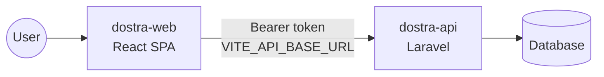
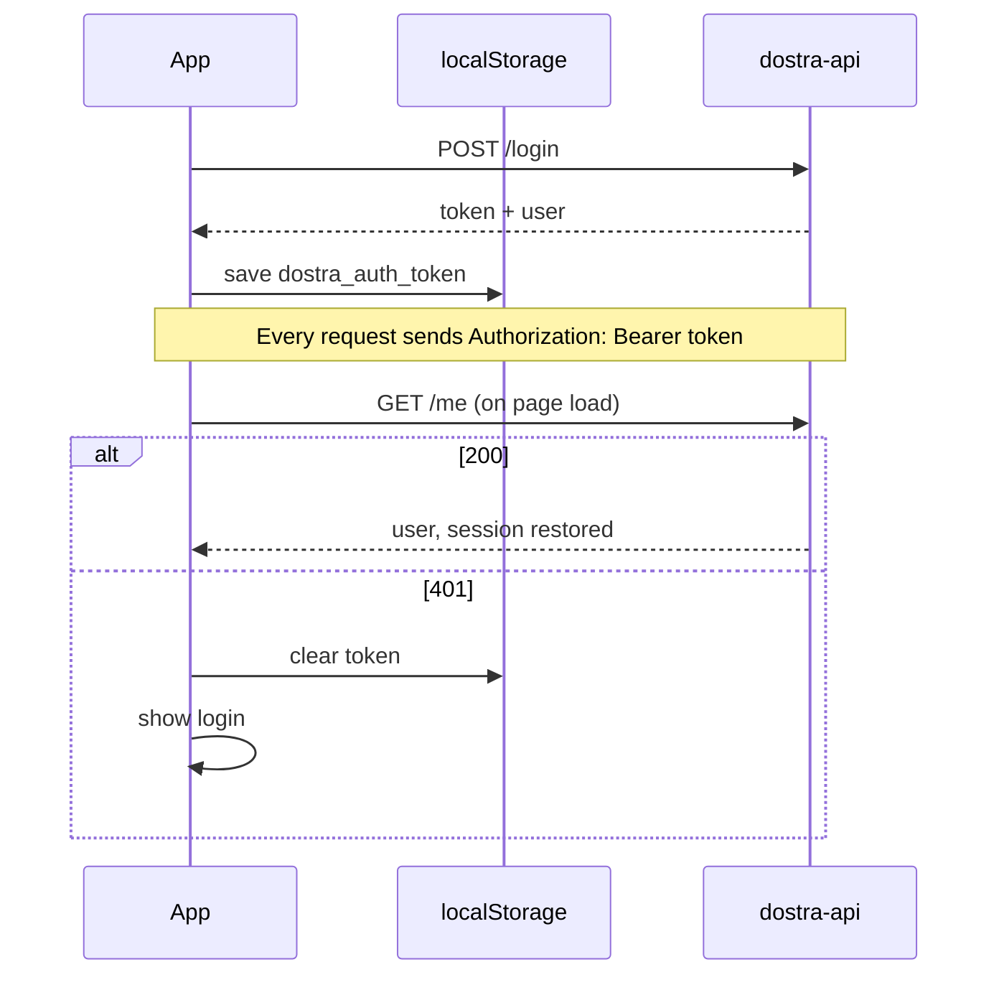

<div align="center">

<br/>

```
██████╗  ██████╗ ███████╗████████╗██████╗  █████╗     ██╗    ██╗███████╗██████╗
██╔══██╗██╔═══██╗██╔════╝╚══██╔══╝██╔══██╗██╔══██╗    ██║    ██║██╔════╝██╔══██╗
██║  ██║██║   ██║███████╗   ██║   ██████╔╝███████║    ██║ █╗ ██║█████╗  ██████╔╝
██║  ██║██║   ██║╚════██║   ██║   ██╔══██╗██╔══██║    ██║███╗██║██╔══╝  ██╔══██╗
██████╔╝╚██████╔╝███████║   ██║   ██║  ██║██║  ██║    ╚███╔███╔╝███████╗██████╔╝
╚═════╝  ╚═════╝ ╚══════╝   ╚═╝   ╚═╝  ╚═╝╚═╝  ╚═╝     ╚══╝╚══╝ ╚══════╝╚═════╝
```

*The CRM dashboard for Dostra: review inbound leads and inspect their payloads*

<br/>

[](https://react.dev/)
[](https://www.typescriptlang.org/)
[](https://vitejs.dev/)
[](https://tailwindcss.com/)
[](https://nginx.org/)

<br/>

[Overview](#-overview) ·
[Quick start](#-quick-start) ·
[Features](#-whats-in-the-app) ·
[Architecture](#-architecture) ·
[API](#-api-usage) ·
[Production](#-production-build) ·
[Status](#-status--known-gaps)

</div>

---

## ✨ Overview

`dostra-web` is the single-page frontend for the Dostra lead-operations CRM. It talks to [`dostra-api`](https://github.com/chetannagar/dostra-api) over REST and lets people:

- 🔐 sign in and stay signed in
- 📊 see a dashboard of recent lead activity
- 📋 browse, search and filter leads
- 🔎 open a lead and inspect the raw webhook payload that created it

It's deliberately small: **no router library, no state library, no UI kit.** Just React, a typed `fetch` wrapper, three hooks and Tailwind.



> Normally run through [`dostra-deploy`](https://github.com/chetannagar/dostra-deploy), which starts it together with the API and database.

---

## 🚀 Quick start

### With Docker (recommended)

From the deploy repo root:

```bash
./scripts/docker-deploy.sh      # web on http://127.0.0.1:5173, API on :8000
```

### Standalone

You need **Node.js 22+** and a running `dostra-api`.

```bash
npm install
cp .env.example .env            # set VITE_API_BASE_URL
npm run dev                     # http://127.0.0.1:5173
```

Sign in with a seeded account (from `dostra-api`'s local seeder):

| Role | Email | Password |
|------|-------|----------|
| Admin | `admin@example.com` | `password` |
| Client | `client@example.com` | `password` |

The login screen is prefilled with the admin credentials.

### Scripts

| Command | What it does |
|---------|--------------|
| `npm run dev` | Vite dev server with hot reload |
| `npm run build` | Type-check (`tsc -b`), then production bundle into `dist/` |
| `npm run preview` | Serve the built bundle locally |
| `npm run lint` | ESLint (TypeScript, React Hooks, React Refresh) |

### Environment

| Variable | Default | Notes |
|----------|---------|-------|
| `VITE_API_BASE_URL` | `http://127.0.0.1:8000/api` | Where the **browser** reaches the API. In Docker this is the host-mapped port, not the container name. |

Vite reads `.env` and `.env.local` (use the latter for machine-specific overrides). Everything prefixed `VITE_` is baked into the bundle at build time and visible to users. **Never put secrets in it.**

---

## 🧭 What's in the app

| Screen | Route | What you get |
|--------|-------|--------------|
| **Login** | `/login` | Email and password form, API error messages, redirects after sign-in |
| **Dashboard** | `/` | Greeting, metric cards with sparklines, 14-day lead histogram, quick-status checks, top clients (admin) or sources (client), and recent leads |
| **Leads** | `/leads` | Filterable, paginated lead table with a side preview of the selected lead |
| **Lead detail** | `/leads/:id` | Full contact details, message, source, client, timestamps and the raw JSON payload |

**Filters** (all kept in the URL, so views are shareable and survive a refresh): client, email, free-text search, date range, page size and page. `?selected=<id>` opens the preview pane.

**Shell:** collapsible sidebar, breadcrumb topbar with live search, light and dark themes. Theme and sidebar state are remembered in `localStorage`.

### Roles

| | Admin | Client |
|---|:---:|:---:|
| Dashboard and leads | All clients | Assigned clients only |
| Client filter | Clients seen in loaded leads | Own assigned clients |
| Clients and Users nav items | Shown, marked *soon* | Hidden |

The server decides what each role may see. The UI only adapts its labels and navigation.

---

## 🏗 Architecture

```
src/
├── main.tsx                 # entry point
├── App.tsx                  # shell, path routing, wiring
├── components/
│   ├── LoginView.tsx
│   ├── DashboardView.tsx    # metric cards, sparkline, histogram
│   ├── LeadListPanel.tsx    # filters, table, preview pane
│   ├── LeadDetailCard.tsx   # detail view and payload viewer
│   ├── Sidebar.tsx · Topbar.tsx
│   ├── ClientManagementView.tsx · UserManagementView.tsx   # placeholders (not mounted yet)
│   └── Icon.tsx · DostraLogo.tsx
├── hooks/
│   ├── useAuthSession.ts    # login, logout, token restore
│   ├── useLeadWorkspace.ts  # lead list and detail loading, dashboard derivation
│   └── useAdminResources.ts # stub for future admin screens
├── services/api.ts          # fetch wrapper, token storage, snake_case → camelCase mapping
├── types/types.ts           # shared TypeScript types
├── utils/
│   ├── router.ts            # History API helpers, filters ↔ URL query string
│   ├── storage.ts           # theme and sidebar persistence
│   ├── format.ts            # dates, initials, payload helpers
│   └── errors.ts            # ApiError and user-facing messages
└── index.css · styles/admin.css   # Tailwind and design tokens
```

### Key decisions

- **Routing without a library.** `App.tsx` matches `window.location.pathname` and uses `history.pushState` plus a `popstate` listener. In production Nginx falls back to `index.html`, so deep links work.
- **State lives in three hooks.** `useAuthSession` (identity), `useLeadWorkspace` (data) and local `useState` in `App` (theme, sidebar, location). No Redux, Zustand or React Query.
- **URL as state.** Filters and the selected lead are serialised to the query string by `utils/router.ts`.
- **One API boundary.** Components never call `fetch`. They use `services/api.ts`, which maps the API's snake_case into camelCase domain types.
- **React Compiler is on** (`babel-plugin-react-compiler`), so manual `useMemo` and `useCallback` are rarely needed.
- **Design tokens** are CSS variables (`--bg`, `--surface`, `--ink`, `--line`, `--signal`...) switched by `data-theme` on `<html>`.

### Auth flow



A `401` from any lead request clears the session and returns to `/login`.

---

## 🔌 API usage

The app uses these endpoints. Anything else in the API is not consumed yet.

| Call | Used for |
|------|----------|
| `POST /login` | Sign in |
| `GET /me` | Restore a session |
| `POST /logout` | Sign out (the local session is cleared even if this fails) |
| `GET /leads` | Lead list. Params: `client_id`, `email`, `search`, `from`, `to`, `per_page`, `page` |
| `GET /leads/{id}` | Lead detail |
| `GET /clients` | Admin client count in the topbar |
| `GET /users` | Wrapped in `api.ts`, not yet used by a screen |

Error handling (`utils/errors.ts`) turns `401`, `403`, `422` and `429` into readable messages and falls back to a hint to check that the backend is running and `VITE_API_BASE_URL` is correct.

More detail: [`FRONTEND_API_INTEGRATION.md`](FRONTEND_API_INTEGRATION.md).

---

## 🎨 Design

The visual design was prototyped first. The brief and the HTML prototype are kept in `docs/`:

- [`docs/design.MD`](docs/design.MD): product scope, screens and data model
- `docs/Prototype_handoff/`: the interactive prototype (open `prototype/Dostra Frontend Design.html`)

---

## 🏭 Production build

`Dockerfile.prod` builds in two stages and ships only static files:

1. **Builder** (`node:22-bookworm-slim`): `npm ci`, then `npm run build`
2. **Runner** (`nginx:1.27-alpine`): serves `dist/` with the config in `nginx.conf`

`nginx.conf` provides:

- SPA fallback to `index.html` for client-side routes
- 1-year immutable caching for hashed assets
- `no-store` for `index.html`, so a deploy is picked up immediately
- gzip for text assets

```bash
docker build -f Dockerfile.prod \
  --build-arg VITE_API_BASE_URL=https://yourdomain.com/api \
  -t dostra-web .
```

> ⚠️ `VITE_API_BASE_URL` is baked in at **build time**. Changing it means rebuilding the image.

In production the container sits behind the deploy repo's Nginx reverse proxy, which sends `/api` and `/admin` to Laravel and everything else here. See [`dostra-deploy/docs/DEPLOY.md`](https://github.com/chetannagar/dostra-deploy/blob/master/docs/DEPLOY.md).

---

## 🚧 Status & known gaps

What works today: login and session restore, dashboard, filtered and paginated leads, lead detail with payload viewer, themes, and the production image.

Known gaps:

- **`super_user` role is not modelled.** The API has three roles (`super_user`, `admin`, `client`), but the UI types only know `admin` and `client`. A `super_user` signing in is treated as a non-admin by the UI. Use an `admin` account in the dashboard, and `super_user` for the Filament panel at `/admin`.
- **Dashboard numbers are partly derived.** Metrics are computed from the leads loaded in the current page (up to 50). Several deltas (like `+12%`) and the "Ingestion errors" tile are placeholders, not real data.
- **Greeting is fixed.** It always says "Good afternoon".
- **Disabled controls marked *soon*:** Filters button, Add lead, Edit lead, and the Clients and Users pages. The `ClientManagementView` and `UserManagementView` components and `useAdminResources` are stubs.
- **Read-only.** The API supports creating and editing clients and users, but no screen uses it yet.
- **No automated tests.** Vitest is installed but there are no test files or `test` script yet.
- **Leads are not editable.** Leads are created by the webhook and are read-only in the API.

### Roadmap

- [ ] Add `super_user` to the role types and treat it as admin
- [ ] Clients screen: list, create, edit, rotate webhook secret
- [ ] Users screen: list, create, edit, assign clients
- [ ] Real dashboard figures from a server-side stats endpoint
- [ ] Wire up the Filters drawer
- [ ] Vitest and Testing Library coverage for hooks and `services/api.ts`

---

## 📄 License

Internal use only. Add a licence file if this becomes public.

---

<div align="center">
<sub>Built with React · TypeScript · Vite · Tailwind</sub>
</div>
